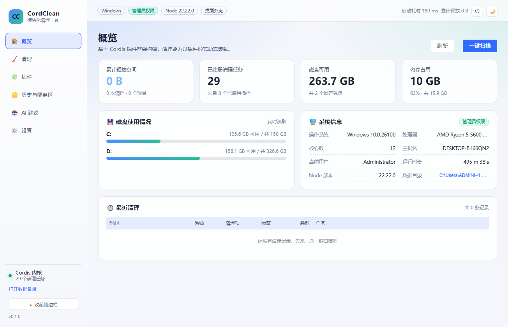
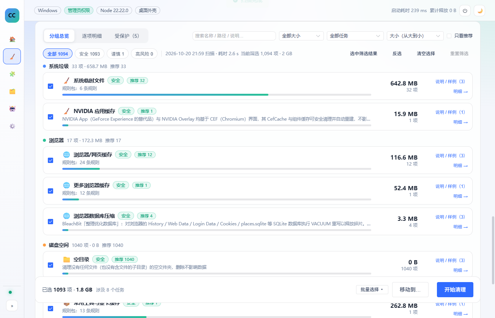

# CordClean

基于 [Cordis](https://github.com/cordiverse/cordis) 插件框架的模块化 Windows 电脑清理工具。清理能力全部由插件提供，规则以数据形式描述，删除统一走「补偿链 → 清理票据 → 执行器」的安全通道。

> 仅支持 Windows 10/11。默认删除到回收站，高风险项可进隔离区，可恢复。

## 界面预览

| 概览 | 扫描与清理 |
| --- | --- |
|  |  |

| 插件管理 | AI 顾问配置 |
| --- | --- |
|  |  |

| 设置（含定时任务） | 深色主题 |
| --- | --- |
|  |  |

| AI 顾问（流式 / 截图诊断 / 取消生成） |
| --- |
|  |

## 功能

- **模块化清理**：规则库、回收站、大文件、重复文件、空目录、注册表残留、启动项、快捷方式、定时任务、AI 顾问等 11 个内置插件，可独立启停、热重载、改配置。
- **规则即数据**：30 个分类、270+ 条规则从 JSON 导入，新增清理域通常只需要加数据，不用写代码。
- **安全链**：路径白名单 + 受保护目录 + 预览一致性 + 预算 + 回收站/隔离区；删除前目录预检，占用文件整目录跳过，避免"删一半"。
- **AI 顾问**：分析磁盘画像与脱敏上下文，给出清理建议、从扫描结果中挑选清理项、生成规则并可试运行、甚至生成单文件插件草稿（需人工审阅后安装）。
- **定时任务**：按间隔或每天固定时间扫描；可选授权自动清理安全项，授权绑定规则指纹，规则变化后自动失效。
- **可观测**：结构化运行日志、诊断报告导出、清理历史与隔离区管理。

- **AI 顾问（v0.2）**：三种接口形态、Tool Calls、SSE 流式输出与实时面板、Vision 截图诊断、取消生成、输出上限对齐模型（deepseek-flash 384K）。
- **规则治理（v0.2）**：401 条规则可按分类排除，支持单条规则命中统计（命中项/体积 Top 50）。
- **大文件搬家（v0.2）**：移到其他盘不删数据，支持文件/同盘目录、符号链接/junction、同名改名、失败还原。
- **多计划调度（v0.2）**：plans[] + lastRuns 持久化，按计划授权，规则变化自动失效。
## 快速开始（Windows）

需要 **Node.js 22+** 与 **pnpm 12+**。

```bash
pnpm install
pnpm start:web        # 浏览器外壳（默认 http://127.0.0.1:7801/）
pnpm start:desktop    # Electron 桌面版
```

也可以直接双击仓库根目录的启动脚本：

| 脚本 | 行为 |
| --- | --- |
| `1-启动网页版-后台运行.bat` | 显示启动提示后自动隐藏窗口，浏览器版后台运行 |
| `2-启动网页版-显示控制台.bat` | 前台窗口，实时日志（排错用） |
| `3-启动网页版-完全隐藏.bat` | 无窗口启动 |
| `4-启动桌面版-后台运行.bat` | 桌面版，启动后窗口隐藏 |
| `5-启动桌面版-显示控制台.bat` | 桌面版，显示构建日志 |
| `6-查看运行状态.bat` | 运行中 / 正在启动 / 未运行 |
| `7-关闭CordClean.bat` | 结束全部进程 |

首次运行会检查 Node/pnpm 并安装依赖；依赖已就绪时直接启动，不联网下载。

## 目录结构

```
apps/
  web/            浏览器外壳（HTTP + WebSocket JSON-RPC）
  desktop/        Electron 外壳（IPC 传输）
packages/
  core/           内核：插件管理、清理引擎、补偿链、规则、回收站、隔离区、AI 上下文
  host/           外壳无关的 API 层 + 诊断日志 + 插件工坊校验
  ui/             Vue 3 + Element Plus 界面
  shared/         共享类型与 JSON-RPC 协议
  utils/          路径/文件系统工具（长路径、mapLimit、删除）
  plugins/        内置插件（rule-pack、recycle、large-files、duplicates、
                  empty-dirs、leftovers、startup、registry、ai、scheduler、shortcuts）
tests/            Vitest 测试（190+ 用例）
docs/             架构说明、规则报告、缺陷记录、基准测试
scripts/          构建、启动、E2E、诊断等脚本
```

## 安全设计

1. **唯一删除入口**：`ctx.executor` 只接受补偿链签发的 `CleanTicket`，插件无法直接删除文件。
2. **路径策略**：插件必须声明清理辖区；受保护目录（Windows、Program Files、System32 等）及其祖先目录不可删，盘符根拒绝。
3. **预览一致性**：文件在扫描后被修改（mtime 差 >2s 或大小变化）会被拒绝；变化率超过 5% 中止整次清理。
4. **预算**：单次清理默认上限 5 万文件 / 20GB。
5. **回收站优先**：默认进回收站；回收站不可用不会降级为永久删除；高风险项可强制隔离区。
6. **占用保护**：删除目录前递归预检，任一文件被占用/不可写则整目录跳过，避免部分删除。
7. **可追溯**：每次清理记录字节去向（释放 / 回收站 / 隔离区 / 失败），并写入历史。

## 开发

```bash
pnpm install
pnpm exec tsc -p tsconfig.json --noEmit   # 类型检查
pnpm test                                  # 构建 UI + 运行测试
pnpm build                                 # UI + 桌面构建
node scripts/e2e-ui.mjs                    # 端到端界面检查
```

### 写一个插件

插件是一个导出 `defineCleanerPlugin` 的 ESM 模块：

```ts
import { defineCleanerPlugin } from '@cordclean/shared'

export default defineCleanerPlugin({
  name: 'demo',
  inject: ['cleaner'],
  setup(ctx) {
    ctx.cleaner.define({
      id: 'demo-task',
      name: '示例任务',
      category: 'system',
      risk: 'safe',
      icon: '🧪',
      defaultSelected: false,
      targets: [],
      scan(scan) {
        // 只 emit 候选，删除交给内核
      },
    })
  },
})
```

也可以在界面「插件 → 添加插件」直接加载本地 `.mjs`（仅本次运行有效）。

## AI 配置

在「AI 建议」页填写 API Key（仅保存在本机 `config.json`，不会写入仓库），或设置环境变量 `DEEPSEEK_API_KEY`。默认模型 `deepseek-flash`。所有外发请求都会脱敏并可在「外发记录」中查看。

## 许可

[MIT](LICENSE) © 2026 CordClean Contributors

## 免责声明

本工具会删除文件。请在使用前确认清理项，保持默认的回收站/隔离区模式，并自行承担使用风险。

## v0.2.0 更新

- AI：Tool Calls、流式输出、Vision 截图诊断、取消生成、输出上限对齐模型（deepseek-flash 384K）
- 规则库：单条规则命中统计、分类排除配置
- 大文件：搬家到其他盘（文件/同盘目录、符号链接/junction、失败还原）
- 定时任务：多计划、运行时间持久化、按计划授权
- 平台：外部插件 worker 隔离、能力声明、配置热更新、RPC zod 校验、会话中断标记

