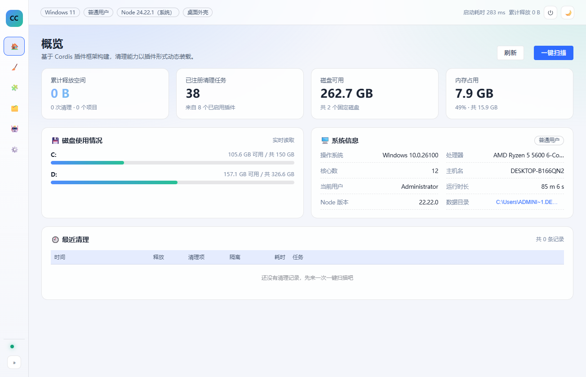
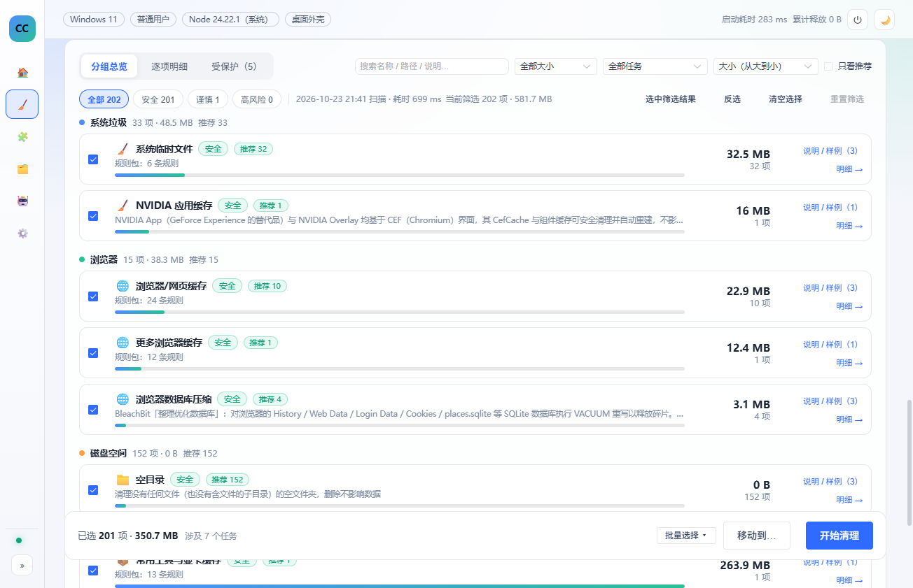
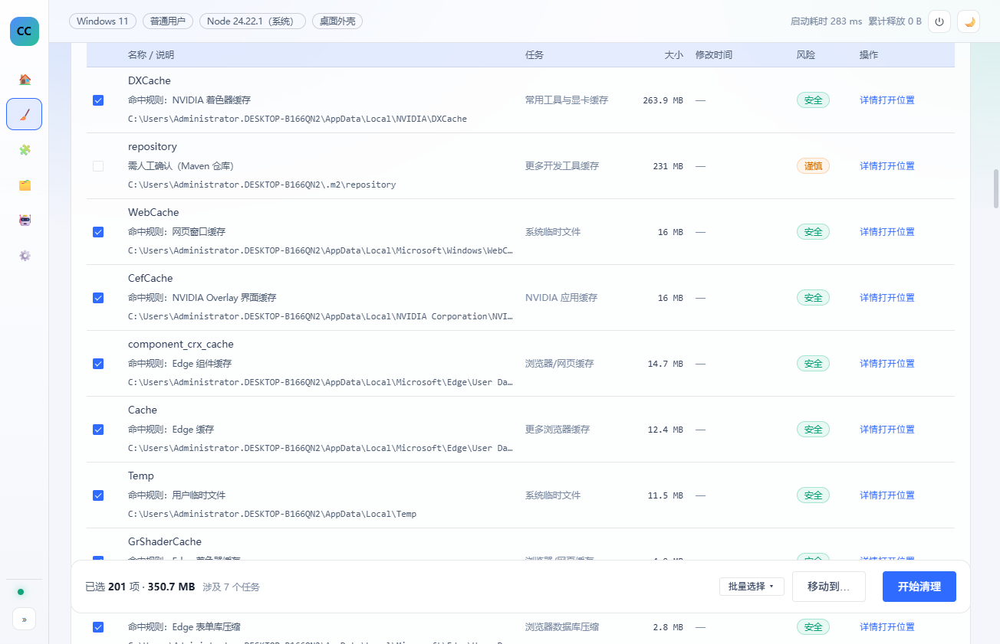
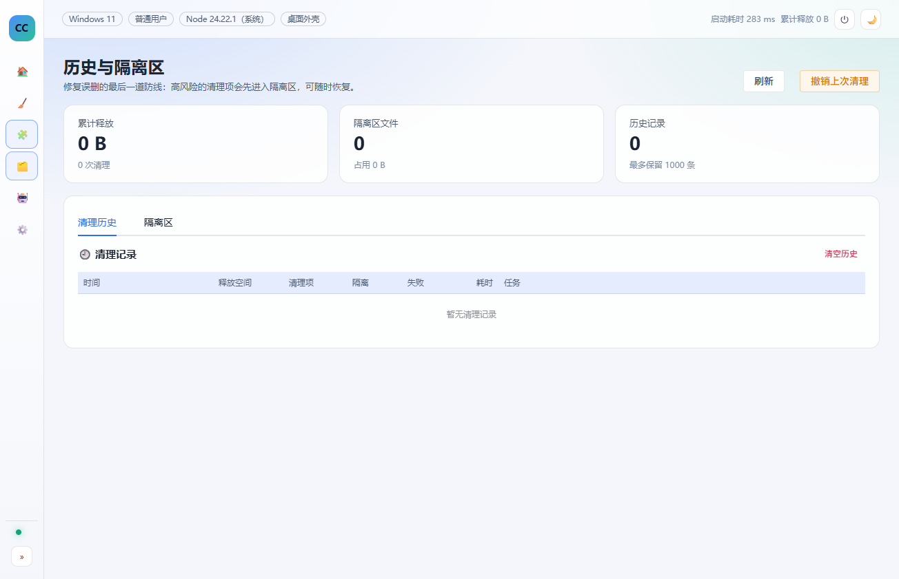
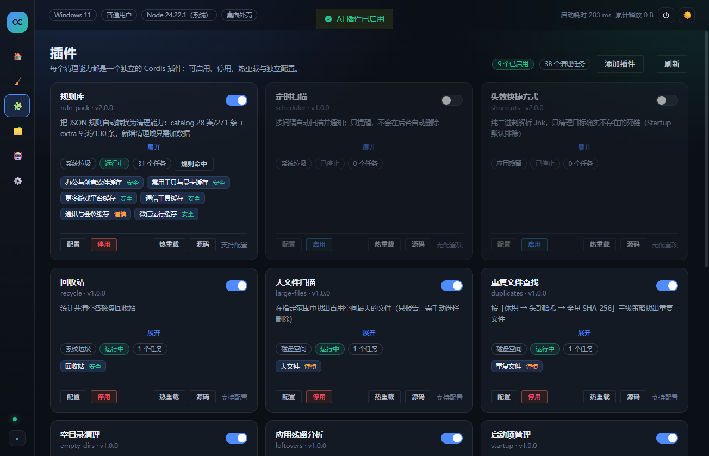

# CordClean · 基于 Cordis 插件框架的模块化电脑清理工具

> 本科毕业设计项目《基于 Cordis 插件框架的模块化电脑清理工具设计与实现》配套系统。
>
> 目标不是再做一款「CCleaner 克隆」，而是验证一件事：**把"清理能力"抽象成插件，用插件框架统一管理生命周期、依赖、配置与安全边界**，从而让工具可扩展、可裁剪、可审计。

当前版本 `0.5.11`；11 个内置插件（8 个默认启用）、默认 38 个清理任务、55 个 RPC 方法；54 个测试文件 / 382 个用例。

## 快速开始

**Windows 一键启动（推荐）**：双击仓库根目录的 `1-启动网页版-后台运行.bat`

- 自动检查 Node.js / pnpm；
- 依赖已安装 → **跳过 pnpm install**，直接启动浏览器版（约 1~2 秒）；
- 首次运行或依赖缺失 → 自动 `pnpm install`（已内置 Electron 国内镜像）；
- 想启动桌面版：双击 `4-启动桌面版-后台运行.bat`（或 `5-启动桌面版-显示控制台.bat`）。

手动方式：

```bash
pnpm install
pnpm start:web        # 浏览器外壳
pnpm start:desktop    # Electron 桌面应用
```
## 1. 核心特性

| 能力 | 说明 |
| --- | --- |
| 插件化清理 | 11 个内置插件（8 个默认启用）、默认 38 个清理任务，每个插件独立启停、独立配置、热重载 |
| 运行时插件管理 | 「插件」页面可启用/停用/热重载插件，配置写入 `config.json`，无需重启应用 |
| 通用插件框架 P1 | 外部插件可按原生 Cordis 插件加载，拥有完整 `ctx`；可贡献概览卡片、状态栏、命令、iframe 沙箱页面；主动事件/通知可实时刷新 UI；Electron 壳提供悬浮窗口/托盘；旧 worker cleaner 插件继续兼容 |
| 安全策略 | 路径策略（保护系统/用户重要目录）+ 隔离区（可恢复）+ 注册表 `.reg` 备份；本地服务随机 token + Host/Origin 校验（见 [威胁模型](docs/threat-model.md)） |
| 扫描/清理分离 | 先扫描出「可清理项」，用户勾选后再执行；支持 `dryRun` 预演；扫描与清理都有独立实时进度页，切换侧边栏不会中断 |
| 定时任务 | 多计划定时扫描；每个任务可自定义名称、按间隔或每天固定时间运行；自动清理需授权，规则变化后授权失效 |
| 扫描结果选择 v2 | 千条级结果按「分类 → 任务」聚合；安全项智能推荐，谨慎/高风险项显式确认；支持风险/大小/任务筛选、三态整组勾选、逐项明细 + 详情说明 + 打开位置、受保护只读视图、清理确认摘要 |
| 双外壳 | 同一内核与界面，可运行在浏览器（HTTP + WebSocket）或 Electron（IPC）中 |
| AI 顾问插件 | 把脱敏的本机画像交给 DeepSeek 等 OpenAI 兼容接口，产出结构化清理建议 |
| AI 插件工坊 | 生成原生 Cordis 通用插件（cleaner/widget/active/desktop），支持 UI 卡片/iframe 页面、持久化与重启自动加载；可声明 npm 依赖（用户确认后下载，禁用 lifecycle scripts）；生成后静态契约 + 语法校验，失败自动重试，安装前真实加载 |
| 可观测 | 扫描/清理进度事件、结构化日志、清理历史、失败归因 |

## 2. 技术栈

- **内核**：Node.js 22+ / TypeScript / [Cordis](https://github.com/cordiverse/cordis) 4（`cordis@4.0.0-rc.11`）插件框架
- **配置校验**：Schemastery（Cordis 生态的 schema 库）+ zod（RPC 参数校验）
- **界面**：Vue 3 + Vite + Element Plus
- **传输层**：JSON-RPC 2.0（WebSocket / Electron IPC 双实现，`ApiMap` 共 55 个方法）
- **桌面外壳**：Electron 38（`sandbox: true` + `contextIsolation: true`）
- **测试**：Vitest（382 个用例 / 51 个文件）
- **构建**：esbuild（主进程）+ Vite（界面）

## 3. 架构总览

```
┌──────────────────────────────────────────────────────────────────────┐
│                          外壳层（可替换）                             │
│   apps/web  ──────────────┐          ┌──────────────  apps/desktop   │
│   HTTP + WebSocket 服务    │          │   Electron 主进程 + preload    │
└───────────────────────────┼──────────┼───────────────────────────────┘
                            │ JSON-RPC │
┌───────────────────────────▼──────────▼───────────────────────────────┐
│                     传输层 packages/host                             │
│   api.ts：55 个 RPC 方法（与传输无关）   server.ts：静态资源 + WS      │
│   Host/Origin/token 校验、CSP 注入、WS 1MB 上限、畸形 URL → 400       │
└───────────────────────────┬──────────────────────────────────────────┘
                            │ 直接调用
┌───────────────────────────▼──────────────────────────────────────────┐
│                       内核层 packages/core                           │
│  Settings  System  PathPolicy  Quarantine  History  Cleaner         │
│  PluginManager（后者用 ctx.plugin 装载所有清理插件）                  │
└───────────────────────────┬──────────────────────────────────────────┘
                            │ ctx.cleaner.define(...)
┌───────────────────────────▼──────────────────────────────────────────┐
│                  插件层 packages/plugins/*（11 个）                   │
│  rule-pack scheduler shortcuts recycle large-files duplicates        │
│  empty-dirs leftovers startup registry ai                            │
└───────────────────────────┬──────────────────────────────────────────┘
                            │ 只依赖契约与工具
┌───────────────────────────▼──────────────────────────────────────────┐
│            契约 packages/shared（纯类型）  工具 packages/utils        │
└──────────────────────────────────────────────────────────────────────┘
```

关键设计点：**插件只依赖 `shared` + `utils`，不依赖内核实现**。插件看到的是 `ctx.cleaner` / `ctx.pathPolicy` 这样的能力契约（由 `declare module 'cordis'` 做类型增强），因此内核可以替换实现而不影响插件，插件也可以被内核在运行时装卸。插件的信任边界与残余风险见 [威胁模型](docs/threat-model.md)。

## 4. 目录结构

```
.
├── apps/
│   ├── web/                  # Web 外壳：内核 + HTTP/WS 服务（回环监听 + token）
│   └── desktop/              # Electron 外壳：主进程 + preload（sandbox + CSP）
├── packages/
│   ├── shared/               # 契约层：类型、常量、纯函数、Context 类型增强
│   ├── utils/                # 工具层：路径、遍历、文件操作、命令、哈希
│   ├── core/                 # 内核：服务实现 + 插件管理器 + 内置插件清单
│   ├── host/                 # 传输层：RPC 方法 + WebSocket/HTTP 宿主
│   ├── ui/                   # 界面：Vue 3 单页应用
│   └── plugins/              # 11 个清理插件（每个是一个独立包）
├── tests/                    # Vitest 测试（53 个文件 / 377 用例）
├── bench/                    # 性能基准脚本
├── scripts/                  # 构建、冒烟测试、插件自测、Mock LLM、E2E
└── docs/                     # 架构、威胁模型、插件规范、论文素材
```

## 5. 快速开始

要求：Windows 10/11、Node.js ≥ 22、pnpm 12（`packageManager` 固定 `pnpm@12.14.0`，可用 corepack 自动切换）。

```bash
pnpm install

# 方式一：浏览器外壳（推荐开发调试）
pnpm dev:web          # 打开 http://127.0.0.1:7801/

# 方式二：Electron 桌面应用
pnpm start:desktop

# 其它命令
pnpm test             # 单元/集成测试（会先构建 UI）
pnpm typecheck        # 类型检查（tsc，覆盖 packages/apps/bench/tests 的 TS 源码）
pnpm typecheck:ui     # Vue 模板类型检查（vue-tsc）
pnpm bench            # 性能基准（输出 docs/benchmark.md）
pnpm smoke            # 内核冒烟测试
pnpm mock:llm         # 本地 Mock 大模型接口（7899 端口）
```

端到端检查需要先构建桌面产物：

```bash
pnpm build:desktop    # 生成 apps/desktop/dist/main.mjs（e2e-ui.mjs 的前置）
node scripts/e2e-ui.mjs
pnpm exec tsx scripts/audit-plugins.ts   # 内置插件真实扫描审计（只读）
node scripts/verify-clean-ui.mjs         # 3000 条 mock 数据的清理页选择体验验收（无头 Edge，需先 build:ui）
```

环境变量：

| 变量 | 作用 |
| --- | --- |
| `CORDCLEAN_DATA` | 数据目录（默认 `%LOCALAPPDATA%\CordClean`） |
| `CORDCLEAN_PORT` | Web 外壳端口（默认 7801；仅监听回环地址） |
| `CORDCLEAN_LOG` | 日志等级 `debug/info/warn/error` |
| `CORDCLEAN_NO_OPEN` | 设为 `1` 时不自动打开浏览器 |
| `CORDCLEAN_UI_DIR` | 覆盖界面静态资源目录（默认 `packages/ui/dist`） |
| `DEEPSEEK_API_KEY` / `OPENAI_API_KEY` / `DASHSCOPE_API_KEY` | AI 插件的 API Key（也可在插件配置里填） |

## 6. 内置插件

| 插件 | 任务 | 风险 | 说明 |
| --- | --- | --- | --- |
| `rule-pack` | 规则库（默认 31 类 / 312 条规则任务） | 安全~高风险 | 数据驱动：catalog + extra 两套 JSON，新增清理域只需加数据（见 §6.2） |
| `scheduler` | —（定时扫描，不产生清理任务） | — | 多计划扫描并通知；每个任务可自定义名称；默认禁用，`clean` 模式需显式授权，授权与任务范围/模式绑定 |
| `shortcuts` | 失效快捷方式 | 高风险 | 纯二进制解析 `.lnk`，只清理目标不存在的死链；默认禁用 |
| `recycle` | 回收站 | 安全 | 解析 `$I/$R` 结构，按原始路径展示 |
| `large-files` | 大文件 | 谨慎 | 只报告，需手动勾选 |
| `duplicates` | 重复文件 | 谨慎 | 体积 → 4KB 头部哈希 → 全量 SHA-256 三级策略 |
| `empty-dirs` | 空目录 | 安全 | 跳过 junction/node_modules |
| `leftovers` | 应用残留 | 高风险 | 注册表卸载项比对；目录类只提示 |
| `startup` | 启动项 | 谨慎 | Run/RunOnce、启动文件夹、计划任务；删除前导出 `.reg`（需管理员） |
| `registry` | 注册表问题 | 高风险 | 无效卸载项 / App Paths；删除前导出 `.reg`（需管理员） |
| `ai` | —（提供 `ctx.ai` 服务） | — | 三种接口形态、模型与推理等级可配置；默认禁用（见 §6.1） |

> 默认启用 8 个插件（rule-pack + recycle/large-files/duplicates/empty-dirs/leftovers/startup/registry），
> 默认任务 38 个 = 规则库 31 + 插件 7；在设置里启用 `shortcuts` 后会多一个任务。

### 6.1 AI 顾问：接口可配置、可演进

大模型接口是最容易变的部分（DeepSeek 已把 `deepseek-chat` 换成 `deepseek-flash`，
并新增了思考模式 / 推理等级）。因此 AI 插件刻意不把任何接口细节写死：

> 官方当前请求 ID：`deepseek-flash`（实际由 **DeepSeek-V4.1-Flash-1017** 提供服务）与
> `deepseek-v4-pro`（DeepSeek-V4-Pro-0813）；旧 ID `deepseek-v4-flash` 等仍被接受但已退役。
> 插件会把有官方说明的旧 ID 迁移到稳定 ID；`/models` 的显示名/上下文/输出上限才是运行时依据，
> 未知模型名则原样保留。完整约定见 [AI 模型与接口兼容策略](docs/ai-model-compatibility.md)。

| 配置项 | 作用 |
| --- | --- |
| `apiShape` | `chat` / `messages` / `responses` 三种形态，分别对应 `/chat/completions`、`/anthropic/v1/messages`、`/responses` |
| `baseUrl` + `chatPath` + `modelsPath` | 地址与路径都可改；`messages` 形态会自动补 `/anthropic` 前缀 |
| `model` | 默认 `deepseek-flash`；自由文本，可手动输入任意模型名；界面「获取模型」从 `/models` 动态拉取候选（失败则用内置目录），并显示模型版本/上下文 |
| `reasoningEffort` | `auto/off/low/medium/high/max`，按形态映射：chat → `thinking`+`reasoning_effort`，messages → `output_config.effort`，responses → `reasoning.effort` |
| `jsonMode` | chat 用 `response_format`，responses 用 `text.format`，messages 用提示词约束 |
| `maxTokens` | 最大输出 token；默认 3000，按 `/models` 的 `max_output_tokens` 上限收敛，不再静默抬高 |
| `extraBody` | **逃生舱**：任意 JSON 深合并进请求体，可覆盖上述所有字段；厂商新增参数时改这里即可 |
| `extraHeaders` | 追加/覆盖请求头（代理、beta 开关、自定义鉴权） |
| `systemPrompt` | 覆盖内置提示词 |
| `timeoutMs` / `retries` | 超时与重试（仅对超时/429/5xx 退避重试） |

配套能力：

- **测试连接**（`ai/probe`）：发一条最小请求，返回耗时、HTTP 状态与模型回复，用于排查 Key/地址/模型/参数组合；
- **模型列表**（`ai/models`）：解析 `context_window`、`max_output_tokens`、`input_modalities`、`effort.supported_levels` 等能力信息；
- **思维链展示**：把 `reasoning_content` / `thinking` / `responses.reasoning` 统一解析出来，界面可折叠查看；
- **错误归类**：`AUTH / RATE_LIMIT / SERVER / TIMEOUT / NETWORK / BAD_REQUEST`，消息里保留 HTTP 状态码与厂商原始说明。

实测（`deepseek-flash`，真实 Key，2026-10）：

| 场景 | 耗时 | 输出 token | 思维链 token |
| --- | --- | --- | --- |
| chat + effort=high | 7.0 ~ 8.1 s | ~1370 | ~820 |
| chat + effort=off | 4.0 ~ 4.1 s | ~485 | 0 |
| messages + effort=high | 7.9 s | ~1400 | ~900 |
| responses + effort=high | 7.7 s | ~1370 | ~880 |

> Key 支持配置里填写，或使用环境变量 `DEEPSEEK_API_KEY` / `OPENAI_API_KEY` / `DASHSCOPE_API_KEY`；
> 发送给模型的画像已脱敏（无路径、文件名、用户名），有单元测试断言；
> Key 以明文保存在数据目录 `config.json`（本机同用户可读），残余风险见 [威胁模型](docs/threat-model.md)。

### 6.2 规则库：内容和代码分离

`rule-pack` 插件把 `packages/plugins/rule-pack/rules/` 下的规则自动变成清理任务：

- **来源**：从 PC-Cleaner 的 `rules.json` 导入并持续扩充，两套数据文件：
  - `catalog.json`：**28 个分类 / 271 条规则 / 284 个候选根**（原始导入）；
  - `extra.json`：**9 个分类 / 130 条规则**（后续扩充）；
  - 合计 37 类 / 401 条 / 414 个候选根（同一目标可能被多个分类引用）。
- **默认装载**：非高风险、非 `deepOnly` 的规则默认生效，约 **31 类 / 312 条**；高风险分类（浏览器密码/Cookie、Windows.old、Downloads 大文件等）
  与 `deepOnly` 规则默认不装载，可在设置里打开；
- **分类 → 任务**：一个分类一个任务（`rule:<category>`），风险取组内最高；
- **规则 → 扫描**：支持 7 种已实现类型：`clear_dir`（清空内容）、`delete_dir`、`glob_files`、`glob_dirs`、
  `files_by_rule`（按大小/年龄）、`find_dirs`（按目录名递归找）、`compact_db`（SQLite VACUUM，不删数据）；
- **清空白名单**：`C:\Windows\System32\LogFiles`、`%WINDIR%\Temp` 这类「目录受保护但内容可清」
  的目标通过 `pathPolicy.addClearRoot()` 登记，只允许清空内容、不允许删除目录本身；
  批次1 起 `addClearRoot` 会拒绝盘符根、保护根及其祖先，且外部插件不再获得清空白名单；
- **新增清理域**：在 `catalog.json` / `extra.json` 加一段 JSON，或写进用户规则（`settings.rules.custom`），
  重启/热重载插件即可生效，内核与其它插件零改动。

规则校验与覆盖率由 `scripts/audit-rules.ts` 输出到 [规则库审计报告](docs/rules-report.md)：
结构错误、暂未实现的类型、死目标、重复目标、被路径策略拦截的目标都会列出来。

## 7. 安全设计

详见 [威胁模型与信任边界](docs/threat-model.md)（含 DNS rebinding、插件信任模型与残余风险）。

1. **路径策略**（`packages/core/src/domains/safety/path-policy.ts`）
   - 保护根：Windows、Program Files、ProgramData、用户桌面/文档/图片/视频/音乐/下载、`AppData\Roaming`、恢复分区等；
   - 名称黑名单：`pagefile.sys`、`NTUSER.DAT` 等；
   - **辖区机制**：插件必须 `addRoot()` 声明自己的清理范围，未声明的路径一律拒绝；
   - 拒绝驱动器根目录、拒绝「包含受保护目录」的祖先目录；
   - 清空白名单（`addClearRoot`）拒绝盘符根、保护根及其祖先，避免放大清空范围；
   - 路径规范化：去掉 Windows 会静默忽略的尾部 `.` 与空格，处理 `\\?\` 长路径前缀与 UNC，并把 **8.3 短名**（`PROGRA~1`）一并纳入保护，避免写法差异造成绕过；无法确定的设备/畸形 UNC 路径 fail-closed；
   - 保护目录用**前缀树**匹配，单次校验约 10 µs。
2. **链接祖先检查**（`packages/utils/src/fs-ops.ts` + 清理引擎）
   - 删除前从父目录向上检查到辖区根，**任一祖先为符号链接/联接点即拒绝**，杜绝「辖区内的 junction 把删除引到辖区外」；执行器在真正删除前会再次复核。
3. **隔离区**（`packages/core/src/domains/safety/quarantine.ts`）
   - 谨慎/高风险项先移动到 `%LOCALAPPDATA%\CordClean\quarantine\<session>\`，记录 `manifest.jsonl`，支持一键恢复；
   - 容量与文件数上限、可配置保留天数。
4. **注册表备份**（`startup` / `registry` / `leftovers` 插件）
   - 删除键/值之前先 `reg export` 到 `数据目录\backups\*.reg`，导出失败则放弃删除。
5. **本地服务与外壳**
   - Web 外壳只监听 `127.0.0.1`，每次启动生成 CSPRNG 随机 token（`crypto.randomBytes`），
     静态页面注入 token；`/api/rpc` 与 WebSocket 均校验 token，并校验 **Host**（阻断 DNS rebinding）
     与 **Origin**（阻断跨站页面拿 token 调用）、限制 WS 消息 ≤ 1 MB、非法 URL 返回 400 而不是崩溃；
   - Electron 外壳 `sandbox: true` + `contextIsolation: true` + `nodeIntegration: false`，preload 只暴露最小 IPC；
     禁止新窗口、非白名单导航被拦截，界面带 CSP；`app/open-path` 使用 `explorer` 参数数组，消除命令拼接注入。

此外：`walk` 默认不跟随链接；删除链接只删链接本身；长路径统一 `\\?\` 前缀；
文件被占用时记录失败而不是中断整个任务；同一清理项重复提交只执行一次；`clean/start` 只接受 `itemIds`，
不信任界面回传的清理项内容。

## 8. 测试与性能

```bash
pnpm test          # 382 个用例 / 51 个文件
pnpm bench         # 性能基准 → docs/benchmark.md
pnpm smoke         # 内核冒烟
pnpm exec tsx scripts/audit-plugins.ts   # 内置插件的真实扫描审计（只读）
pnpm exec tsx scripts/audit-rules.ts     # 规则库审计（校验/死目标/拦截/重复）→ docs/rules-report.md
pnpm exec tsx scripts/import-rules.ts    # 从 PC-Cleaner 重新导入规则目录
pnpm exec tsx scripts/dryrun-clean.ts    # 真实环境预演清理验证（不删除文件）
$env:DEEPSEEK_API_KEY='sk-...'; pnpm exec tsx scripts/ai-live-test.ts   # AI 插件真实接口联调（三形态）
pnpm build:desktop && node scripts/e2e-ui.mjs   # Electron 界面端到端点检（CDP）
node scripts/verify-clean-ui.mjs         # 3000 条 mock 数据的清理页选择体验验收（无头 Edge）
```

测试覆盖：

| 测试文件 | 关注点 |
| --- | --- |
| `path-policy` / `path-attack` / `paths-normalize` | 保护目录、辖区边界、14 种路径写法绕过、`\\?\` 长路径/UNC 规范化 |
| `fs-safety` | 联接点/符号链接、只读文件、长路径、中文/emoji 文件名 |
| `engine` / `engine-robust` | 扫描/清理、取消、截断、去重、失败归因、自定义清理 |
| `plugins` / `plugins-robust` / `external-proxy` / `external-install` | 启停、热重载、配置校验、异常隔离、外部插件信任边界 |
| `quarantine` / `state` / `undo` | 隔离与恢复、设置边界、历史健壮性、撤销凭据 |
| `rpc` / `host-server` / `batch1-hardening` | 鉴权、错误码、超大请求体、目录穿越、Host/Origin、原型污染、clearRoot 边界 |
| `ai` / `ai-robust` / `ai-shapes` | 三种接口形态、推理等级映射、extraBody 逃生舱、模型列表、探测、重试、隐私约束 |
| `rule-pack-evaluator` / `plugin-rules` | 规则评估与引擎 protected 语义对齐、回收站 `$I` 解析、注册表垃圾键判定 |

实测（2026-10-20 重跑，Windows 11 / Node 24.19，详见 [性能基准](docs/benchmark.md)）：

| 指标 | 数值 |
| --- | --- |
| 内核启动（仅服务） | 5.4 ms |
| 完整启动（11 插件 / 38 任务） | 162.6 ms |
| 扫描吞吐（4000 文件 / 40 目录，0.15 s） | **26 770 文件/秒** |
| 删除吞吐（4000 文件，1.84 s） | **2 178 文件/秒** |
| 隔离区写入 | 1.29 ms/文件 |
| SHA-256 吞吐 | 366 MB/秒 |
| 常驻内存 RSS / 堆内存 | 132.2 MB / 12 MB |

## 9. 界面

截图已随仓库提交在 `docs/screenshots/`，由 `scripts/e2e-ui.mjs` 与 `scripts/verify-clean-ui.mjs`
生成（脚本会直接覆盖更新）。**如果 GitHub 页面里图片显示为空白，通常是图片 CDN
（`raw.githubusercontent.com` / `camo.githubusercontent.com`）被网络拦截，不是文件缺失**：
可直接打开对应文件查看，或使用 GitHub 加速/代理后再刷新。

| 概览 | 清理（v2 分组总览） |
| --- | --- |
|  |  |

| 逐项明细 | 插件管理 |
| --- | --- |
|  |  |

| 历史与隔离区 | AI 建议 |
| --- | --- |
|  |  |

| 设置 | 暗色主题 |
| --- | --- |
|  |  |

图片打不开时可直接点文件： [概览](docs/screenshots/ui-overview.png) ·
[清理结果](docs/screenshots/ui-clean-result.png) · [清理明细](docs/screenshots/ui-clean-items.png) ·
[插件管理](docs/screenshots/ui-plugins.png) · [历史](docs/screenshots/ui-history.png) ·
[AI](docs/screenshots/ui-ai.png) · [设置](docs/screenshots/ui-settings.png) ·
[暗色主题](docs/screenshots/ui-theme-dark.png)

## 10. 扩展一个新清理能力

1. 复制 `packages/plugins/empty-dirs` 为 `packages/plugins/<id>`，改 `package.json` 的 `name`；
2. 按 [插件开发规范](docs/plugin-authoring.md) 实现 `src/index.ts`（`defineCleanerPlugin` + `ctx.cleaner.define`）；
3. 在 `packages/core/src/manifest.ts` 增加一行清单，并把包加入 `packages/core/package.json` 依赖；
4. `pnpm install && pnpm dev:web`，插件即出现在「插件」页面。

内核无需任何改动 —— 这是本课题最核心的设计目标。第三方插件的信任边界与安装风险见
[威胁模型](docs/threat-model.md)：**安装外部插件等同于执行本机代码**，请只安装可信来源。

## 11. 文档索引

- [架构设计](docs/architecture.md) —— 分层结构、Cordis 用法、清理引擎与安全模型，论文第 3、4 章可直接引用
- [威胁模型与信任边界](docs/threat-model.md) —— 本地服务鉴权、插件信任模型、已知残余风险
- [插件开发规范](docs/plugin-authoring.md)
- [通用插件框架（P1 实施记录）](docs/generic-plugin-framework.md) —— 原生 Cordis 外部插件、`ctx.ui` 贡献、通用插件契约的当前进度
- [插件怎么用：被动插件、主动运行与持久化](docs/plugin-usage.md) —— 安装后如何扫描、如何加入定时任务、为什么没有后台常驻插件
- [AI 模型与接口兼容策略](docs/ai-model-compatibility.md) —— 官方模型 ID/版本对照、别名迁移、`/models` 元数据、未来接口变化应对清单
- [扫描结果选择设计](docs/scan-selection-design.md) —— 分组/推荐/风险分层/批量选择/详情说明
- [市面清理工具选择交互调研](docs/research/scan-selection-ux.md) —— 11 个产品的横向对比与可借鉴模式
- [v2 选择体验验收报告](docs/verification/scan-selection-verify.md) —— 验收时的 289 条单测、真实 E2E、3000 条数据的语义与性能验收（历史快照；当前全量 374 条单测）
- [测试设计](docs/test-plan.md) —— 测试分层、命令与已知缺口
- [规则库审计报告](docs/rules-report.md)
- [依赖与升级策略](docs/dependency-policy.md) —— 版本锁定、已清理依赖、答辩后升级清单
- [论文写作大纲](docs/thesis-outline.md) —— 章节结构、图表清单、数据引用
- [缺陷记录](docs/defect-log.md) —— 自测发现并修复的问题（含 1 个高危越界删除与批次1 安全加固）
- [性能基准](docs/benchmark.md)

## 12. 已知限制

- 仅支持 Windows（路径策略、回收站解析、注册表操作均针对 Windows 实现）；
- 未做代码签名与安装包（可用 electron-builder 补充）；
- 计划任务类启动项只报告、不支持在本工具内禁用；
- `Program Files` 下的残留目录只提示、不允许删除（保守策略）；
- 扫描结果不持久化：重启应用后需要重新扫描才能继续清理；
- 8.3 短名解析依赖 `cmd.exe`，失败时静默降级（少一层保护，不影响主流程）。
- AI 插件依赖外网 API，离线时不可用；API Key 以明文保存在本机 `config.json`。
- 安全模型的边界与残余风险（TOCTOU、同用户本地攻击、插件即可信代码等）见 [威胁模型](docs/threat-model.md)。

## 启动脚本一览

| 双击 | 作用 | 窗口 |
| --- | --- | --- |
| `1-启动网页版-后台运行.bat` | 浏览器版（默认） | 最小化，任务栏有图标 |
| `2-启动网页版-显示控制台.bat` | 浏览器版，显示实时日志 | 前台控制台 |
| `3-启动网页版-完全隐藏.bat` | 浏览器版，无窗口常驻 | 无 |
| `4-启动桌面版-后台运行.bat` | Electron 桌面版 | 最小化 |
| `5-启动桌面版-显示控制台.bat` | 桌面版，显示构建/运行日志 | 前台控制台 |
| `6-查看运行状态.bat` | 查看 运行中 / 正在启动 / 未运行 | 前台，按任意键关闭 |
| `7-关闭CordClean.bat` | 结束 CordClean 全部进程（网页/桌面通用） | 前台，按任意键关闭 |

所有启动脚本都是 **Node 实现**（`scripts/launch.mjs` / `status.mjs` / `stop.mjs`），不依赖 PowerShell；
依赖已安装时不会联网下载。界面右上角还有 ⏻ 电源按钮，可一键退出。
