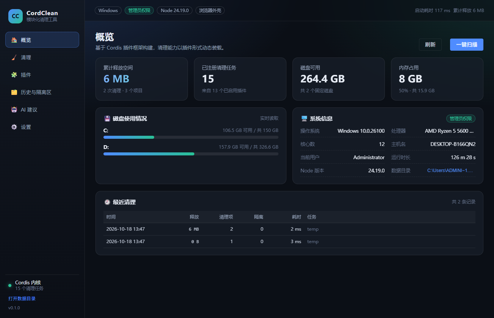
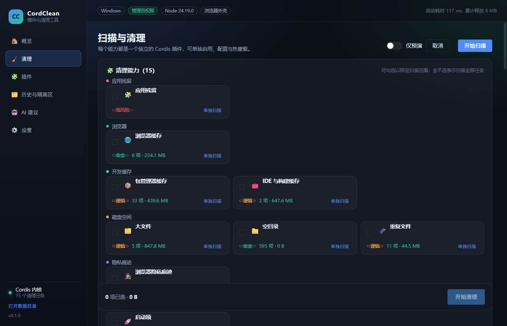
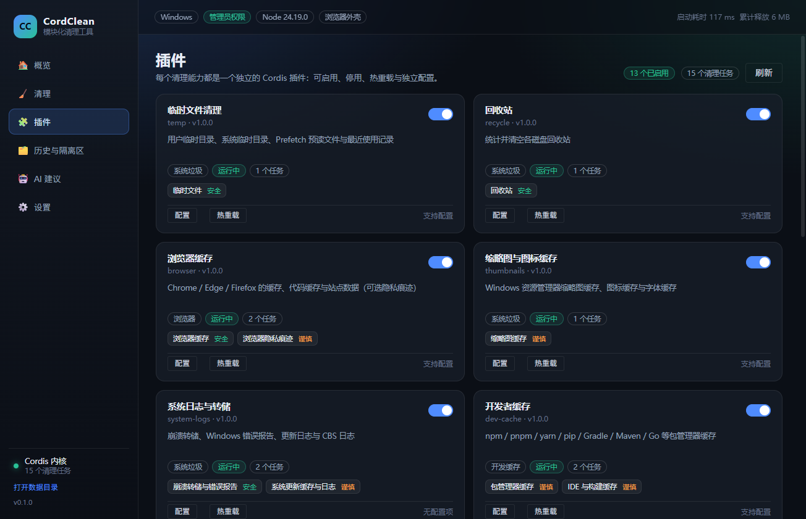
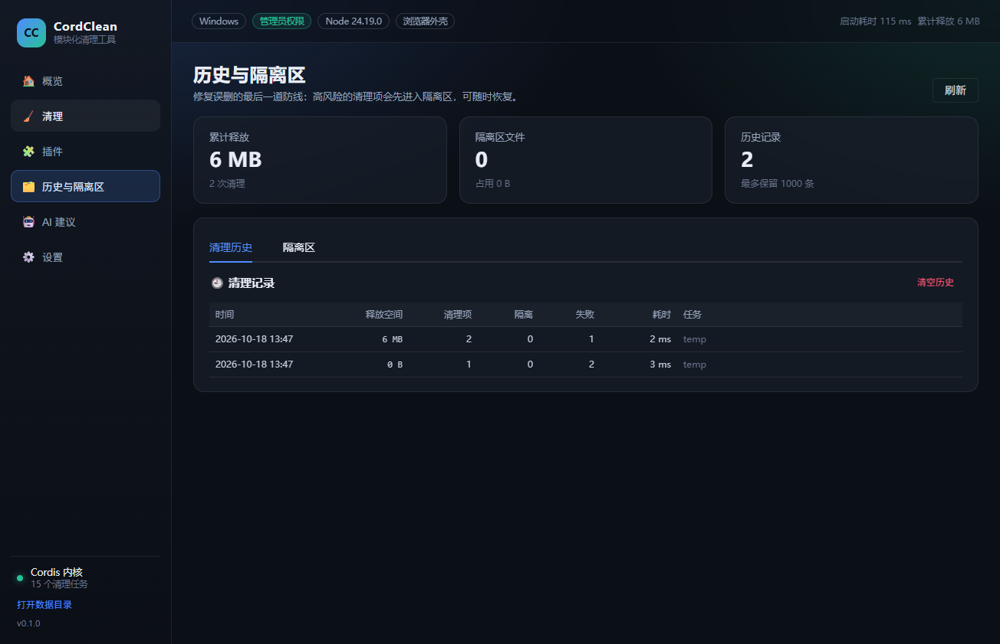
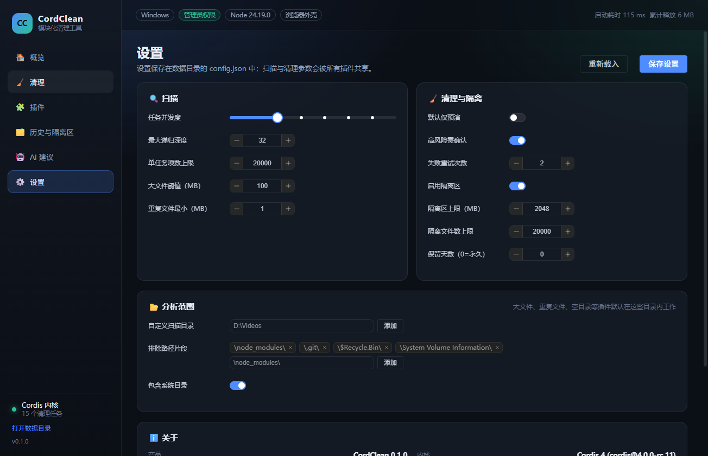

# CordClean · 基于 Cordis 插件框架的模块化电脑清理工具

> 本科毕业设计项目《基于 Cordis 插件框架的模块化电脑清理工具设计与实现》配套系统。
>
> 目标不是再做一款「CCleaner 克隆」，而是验证一件事：**把"清理能力"抽象成插件，用插件框架统一管理生命周期、依赖、配置与安全边界**，从而让工具可扩展、可裁剪、可审计。



## 1. 核心特性

| 能力 | 说明 |
| --- | --- |
| 插件化清理 | 13 个清理插件、15 个清理任务，每个插件独立启停、独立配置、热重载 |
| 运行时插件管理 | 「插件」页面可启用/停用/热重载插件，配置写入 `config.json`，无需重启应用 |
| 安全策略 | 路径策略（保护系统/用户重要目录）+ 隔离区（可恢复）+ 注册表 `.reg` 备份 |
| 扫描/清理分离 | 先扫描出「可清理项」，用户勾选后再执行；支持 `dryRun` 预演 |
| 双外壳 | 同一内核与界面，可运行在浏览器（WebSocket）或 Electron（IPC）中 |
| AI 顾问插件 | 把脱敏的本机画像交给 DeepSeek 等 OpenAI 兼容接口，产出结构化清理建议 |
| 可观测 | 扫描/清理进度事件、结构化日志、清理历史、失败归因 |

## 2. 技术栈

- **内核**：Node.js 22+ / TypeScript / [Cordis](https://github.com/cordiverse/cordis) 4（`cordis@4.0.0-rc.11`）插件框架
- **配置校验**：Schemastery（Cordis 生态的 schema 库）
- **界面**：Vue 3 + Vite + Element Plus
- **传输层**：JSON-RPC 2.0（WebSocket / Electron IPC 双实现）
- **桌面外壳**：Electron 38
- **测试**：Vitest（26 个用例）
- **构建**：esbuild（主进程）+ Vite（界面）

## 3. 架构总览

```
┌──────────────────────────────────────────────────────────────────────┐
│                          外壳层（可替换）                             │
│   apps/web  ──────────────┐          ┌──────────────  apps/desktop   │
│   HTTP + WebSocket 服务    │          │   Electron 主进程 + preload    │
└───────────────────────────┼──────────┼───────────────────────────────┘
                            │ JSON-RPC │
┌───────────────────────────▼──────────▼───────────────────────────────┐
│                     传输层 packages/host                             │
│   api.ts：38 个 RPC 方法（与传输无关）   server.ts：静态资源 + WS      │
└───────────────────────────┬──────────────────────────────────────────┘
                            │ 直接调用
┌───────────────────────────▼──────────────────────────────────────────┐
│                       内核层 packages/core                           │
│  Settings  System  PathPolicy  Quarantine  History  Cleaner         │
│  PluginManager（后者用 ctx.plugin 装载所有清理插件）                  │
└───────────────────────────┬──────────────────────────────────────────┘
                            │ ctx.cleaner.define(...)
┌───────────────────────────▼──────────────────────────────────────────┐
│                  插件层 packages/plugins/*（13 个）                   │
│  temp recycle browser thumbnails system-logs dev-cache large-files   │
│  duplicates empty-dirs leftovers startup registry ai                 │
└───────────────────────────┬──────────────────────────────────────────┘
                            │ 只依赖契约与工具
┌───────────────────────────▼──────────────────────────────────────────┐
│            契约 packages/shared（纯类型）  工具 packages/utils        │
└──────────────────────────────────────────────────────────────────────┘
```

关键设计点：**插件只依赖 `shared` + `utils`，不依赖内核实现**。插件看到的是 `ctx.cleaner` / `ctx.pathPolicy` 这样的能力契约（由 `declare module 'cordis'` 做类型增强），因此内核可以替换实现而不影响插件，插件也可以被内核在运行时装卸。

## 4. 目录结构

```
.
├── apps/
│   ├── web/                  # Web 外壳：内核 + HTTP/WS 服务
│   └── desktop/              # Electron 外壳：主进程 + preload
├── packages/
│   ├── shared/               # 契约层：类型、常量、纯函数、Context 类型增强
│   ├── utils/                # 工具层：路径、遍历、文件操作、命令、哈希
│   ├── core/                 # 内核：服务实现 + 插件管理器 + 内置插件清单
│   ├── host/                 # 传输层：RPC 方法 + WebSocket/HTTP 宿主
│   ├── ui/                   # 界面：Vue 3 单页应用
│   └── plugins/              # 13 个清理插件（每个是一个独立包）
├── tests/                    # Vitest 测试（26 用例）
├── bench/                    # 性能基准脚本
├── scripts/                  # 构建、冒烟测试、插件自测、Mock LLM
└── docs/                     # 架构文档、插件规范、论文素材
```

## 5. 快速开始

要求：Windows 10/11、Node.js ≥ 22、pnpm ≥ 9。

```bash
pnpm install

# 方式一：浏览器外壳（推荐开发调试）
pnpm dev:web          # 打开 http://127.0.0.1:7801/

# 方式二：Electron 桌面应用
pnpm start:desktop

# 其它命令
pnpm test             # 单元/集成测试
pnpm typecheck        # 全量类型检查
pnpm bench            # 性能基准（输出 docs/benchmark.md）
pnpm smoke            # 内核冒烟测试
pnpm mock:llm         # 本地 Mock 大模型接口（7899 端口）
```

环境变量：

| 变量 | 作用 |
| --- | --- |
| `CORDCLEAN_DATA` | 数据目录（默认 `%LOCALAPPDATA%\CordClean`） |
| `CORDCLEAN_PORT` | Web 外壳端口（默认 7801） |
| `CORDCLEAN_LOG` | 日志等级 `debug/info/warn/error` |
| `CORDCLEAN_NO_OPEN` | 设为 `1` 时不自动打开浏览器 |
| `DEEPSEEK_API_KEY` | AI 插件的 API Key（也可在插件配置里填） |

## 6. 内置插件

| 插件 | 任务 | 风险 | 说明 |
| --- | --- | --- | --- |
| `temp` | 临时文件 | 安全 | 用户/系统临时目录、Prefetch、最近使用记录 |
| `recycle` | 回收站 | 安全 | 解析 `$I/$R` 结构，按原始路径展示 |
| `browser` | 浏览器缓存 / 隐私痕迹 | 安全 / 谨慎 | Chrome、Edge、Firefox 逐 profile 识别 |
| `thumbnails` | 缩略图缓存 | 谨慎 | 资源管理器占用时跳过 |
| `system-logs` | 崩溃转储 / 更新缓存 | 安全 / 谨慎 | CrashDumps、WER、CBS、SoftwareDistribution |
| `dev-cache` | 包管理器缓存 / IDE 缓存 | 谨慎 | npm、pnpm、yarn、pip、Gradle、Maven、Go… |
| `large-files` | 大文件 | 谨慎 | 只报告，需手动勾选 |
| `duplicates` | 重复文件 | 谨慎 | 体积 → 4KB 短哈希 → 全量 SHA-256 三级策略 |
| `empty-dirs` | 空目录 | 安全 | 跳过 junction/node_modules |
| `leftovers` | 应用残留 | 高风险 | 注册表卸载项比对；目录类只提示 |
| `startup` | 启动项 | 谨慎 | Run/RunOnce、启动文件夹、计划任务；删除前导出 `.reg` |
| `registry` | 注册表问题 | 高风险 | 无效卸载项 / App Paths；删除前导出 `.reg` |
| `ai` | —（提供 `ctx.ai` 服务） | — | 三种接口形态、模型与推理等级可配置（见 §6.1） |

### 6.1 AI 顾问：接口可配置、可演进

大模型接口是最容易变的部分（DeepSeek 已把 `deepseek-chat` 换成 `deepseek-flash`，
并新增了思考模式 / 推理等级）。因此 AI 插件刻意不把任何接口细节写死：

| 配置项 | 作用 |
| --- | --- |
| `apiShape` | `chat` / `messages` / `responses` 三种形态，分别对应 `/chat/completions`、`/anthropic/v1/messages`、`/responses` |
| `baseUrl` + `chatPath` + `modelsPath` | 地址与路径都可改；`messages` 形态会自动补 `/anthropic` 前缀 |
| `model` | 自由文本；界面「获取模型」会从 `/models` 动态拉取候选（失败则用内置目录） |
| `reasoningEffort` | `auto/off/low/medium/high/max`，按形态映射：chat → `thinking`+`reasoning_effort`，messages → `output_config.effort`，responses → `reasoning.effort` |
| `jsonMode` | chat 用 `response_format`，responses 用 `text.format`，messages 用提示词约束 |
| `extraBody` | **逃生舱**：任意 JSON 深合并进请求体，可覆盖上述所有字段；厂商新增参数时改这里即可 |
| `extraHeaders` | 追加/覆盖请求头（代理、beta 开关、自定义鉴权） |
| `systemPrompt` | 覆盖内置提示词 |
| `timeoutMs` / `retries` | 超时与重试（仅对超时/429/5xx 退避重试） |

配套能力：

- **测试连接**（`ai/probe`）：发一条最小请求，返回耗时、HTTP 状态与模型回复，用于排查 Key/地址/模型/参数组合；
- **模型列表**（`ai/models`）：解析 `context_window`、`max_output_tokens`、`input_modalities`、`effort.supported_levels` 等能力信息；
- **思维链展示**：把 `reasoning_content` / `thinking` / `responses.reasoning` 统一解析出来，界面可折叠查看；
- **错误归类**：`AUTH / RATE_LIMIT / SERVER / TIMEOUT / NETWORK / BAD_REQUEST`，消息里保留 HTTP 状态码与厂商原始说明。

实测（`deepseek-flash`，真实 Key，2026-10）：

| 场景 | 耗时 | 输出 token | 思维链 token |
| --- | --- | --- | --- |
| chat + effort=high | 7.0 ~ 8.1 s | ~1370 | ~820 |
| chat + effort=off | 4.0 ~ 4.1 s | ~485 | 0 |
| messages + effort=high | 7.9 s | ~1400 | ~900 |
| responses + effort=high | 7.7 s | ~1370 | ~880 |


> Key 支持配置里填写，或使用环境变量 `DEEPSEEK_API_KEY` / `OPENAI_API_KEY`；
> 发送给模型的画像已脱敏（无路径、文件名、用户名），有单元测试断言。

## 7. 安全设计（四层防护）

1. **路径策略**（`packages/core/src/services/path-policy.ts`）
   - 保护根：Windows、Program Files、ProgramData、用户桌面/文档/图片/视频/音乐/下载、`AppData\Roaming`、恢复分区等；
   - 名称黑名单：`pagefile.sys`、`NTUSER.DAT` 等；
   - **辖区机制**：插件必须 `addRoot()` 声明自己的清理范围，未声明的路径一律拒绝；
   - 拒绝驱动器根目录、拒绝「包含受保护目录」的祖先目录；
   - 路径规范化：去掉 Windows 会静默忽略的尾部 `.` 与空格，并把 **8.3 短名**（`PROGRA~1`）一并纳入保护，
     同时剥离 `\\?\` 长路径前缀，避免写法差异造成绕过；
   - 保护目录用**前缀树**匹配，单次校验约 10 µs。
2. **链接祖先检查**（`packages/utils/src/fs-ops.ts` + 清理引擎）
   - 删除前从父目录向上检查到辖区根，**任一祖先为符号链接/联接点即拒绝**，
     杜绝「辖区内的 junction 把删除引到辖区外」。
3. **隔离区**（`packages/core/src/services/quarantine.ts`）
   - 谨慎/高风险项先移动到 `%LOCALAPPDATA%\CordClean\quarantine\<session>\`，记录 `manifest.jsonl`，支持一键恢复；
   - 容量与文件数上限、可配置保留天数。
4. **注册表备份**（`startup` / `registry` / `leftovers` 插件）
   - 删除键/值之前先 `reg export` 到 `数据目录\backups\*.reg`，导出失败则放弃删除。

此外：`walk` 默认不跟随链接；删除链接只删链接本身；长路径统一 `\\?\` 前缀；
文件被占用时记录失败而不是中断整个任务；同一清理项重复提交只执行一次。

## 8. 测试与性能

```bash
pnpm test          # 127 个用例 / 14 个文件
pnpm bench         # 性能基准 → docs/benchmark.md
pnpm smoke         # 内核冒烟
pnpm exec tsx scripts/audit-plugins.ts   # 13 个插件的真实扫描审计（只读）
pnpm exec tsx scripts/dryrun-clean.ts    # 真实环境预演清理验证（不删除文件）
$env:DEEPSEEK_API_KEY='sk-...'; pnpm exec tsx scripts/ai-live-test.ts   # AI 插件真实接口联调（三形态）
node scripts/e2e-ui.mjs                  # Electron 界面端到端点检（CDP）
```

测试覆盖：

| 测试文件 | 关注点 |
| --- | --- |
| `path-policy` / `path-attack` | 保护目录、辖区边界、14 种路径写法绕过 |
| `fs-safety` | 联接点/符号链接、只读文件、长路径、中文/emoji 文件名 |
| `engine` / `engine-robust` | 扫描/清理、取消、截断、去重、失败归因、自定义清理 |
| `plugins` / `plugins-robust` | 启停、热重载、配置校验、异常隔离、持久化 |
| `quarantine` / `state` | 隔离与恢复、设置边界、历史健壮性、反复启停不泄漏 |
| `rpc` | 鉴权、错误码、超大请求体、目录穿越、WebSocket、事件广播 |
| `ai` / `ai-robust` / `ai-shapes` | 三种接口形态、推理等级映射、extraBody 逃生舱、模型列表、探测、重试、隐私约束 |
| `plugin-rules` | 回收站 `$I` 二进制解析、注册表垃圾键判定 |

实测（Windows 11 / Ryzen 5 5600 / Node 24.19，详见 [性能基准](docs/benchmark.md)）：

| 指标 | 数值 |
| --- | --- |
| 内核启动（仅服务） | 4.4 ms |
| 完整启动（13 插件 / 15 任务） | 18 ms |
| 扫描吞吐（4000 文件 / 40 目录） | **33 551 文件/秒**（0.12 s） |
| 删除吞吐 | **6 616 文件/秒** |
| 隔离区写入 | 1.38 ms/文件 |
| SHA-256 吞吐 | 384 MB/秒 |
| 全量扫描本机（≈1800 项 / 2.2 GB 可释放） | 6.9 s |
| 单次路径校验 | 10.4 µs |

## 9. 界面

| 概览 | 清理 |
| --- | --- |
|  |  |

| 插件管理 | 历史与隔离区 |
| --- | --- |
|  |  |

| AI 建议 | 设置 |
| --- | --- |
|  |  |

## 10. 扩展一个新清理能力

1. 复制 `packages/plugins/temp` 为 `packages/plugins/<id>`，改 `package.json` 的 `name`；
2. 按 [插件开发规范](docs/plugin-authoring.md) 实现 `src/index.ts`（`defineCleanerPlugin` + `ctx.cleaner.define`）；
3. 在 `packages/core/src/manifest.ts` 增加一行清单，并把包加入 `packages/core/package.json` 依赖；
4. `pnpm install && pnpm dev:web`，插件即出现在「插件」页面。

内核无需任何改动 —— 这是本课题最核心的设计目标。

## 11. 文档索引

- [架构设计](docs/architecture.md) —— 论文第 3、4 章可直接引用
- [插件开发规范](docs/plugin-authoring.md)
- [论文写作大纲](docs/thesis-outline.md) —— 章节结构、图表清单、数据引用
- [缺陷记录](docs/defect-log.md) —— 自测发现并修复的 11 个问题（含 1 个高危越界删除）
- [性能基准](docs/benchmark.md)

## 12. 已知限制

- 仅支持 Windows（路径策略、回收站解析、注册表操作均针对 Windows 实现）；
- 未做代码签名与安装包（可用 electron-builder 补充）；
- 计划任务类启动项只报告、不支持在本工具内禁用；
- `Program Files` 下的残留目录只提示、不允许删除（保守策略）；
- 扫描结果不持久化：重启应用后需要重新扫描才能继续清理；
- 8.3 短名解析依赖 `cmd.exe`，失败时静默降级（少一层保护，不影响主流程）。
- AI 插件依赖外网 API，离线时不可用。
