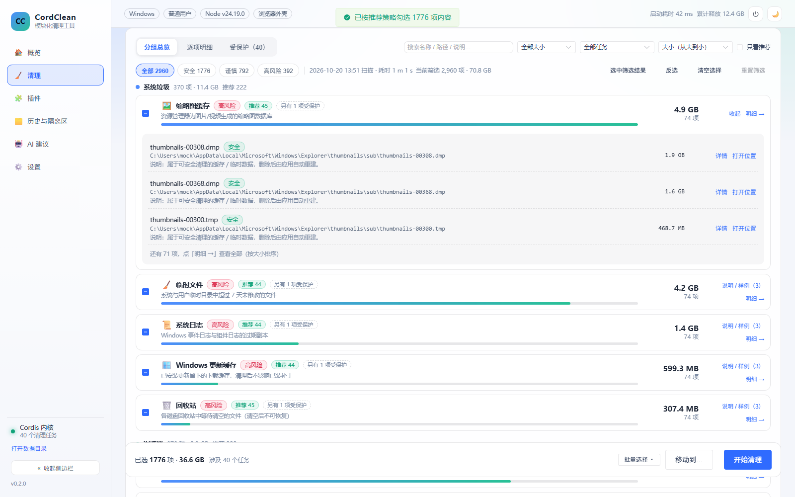
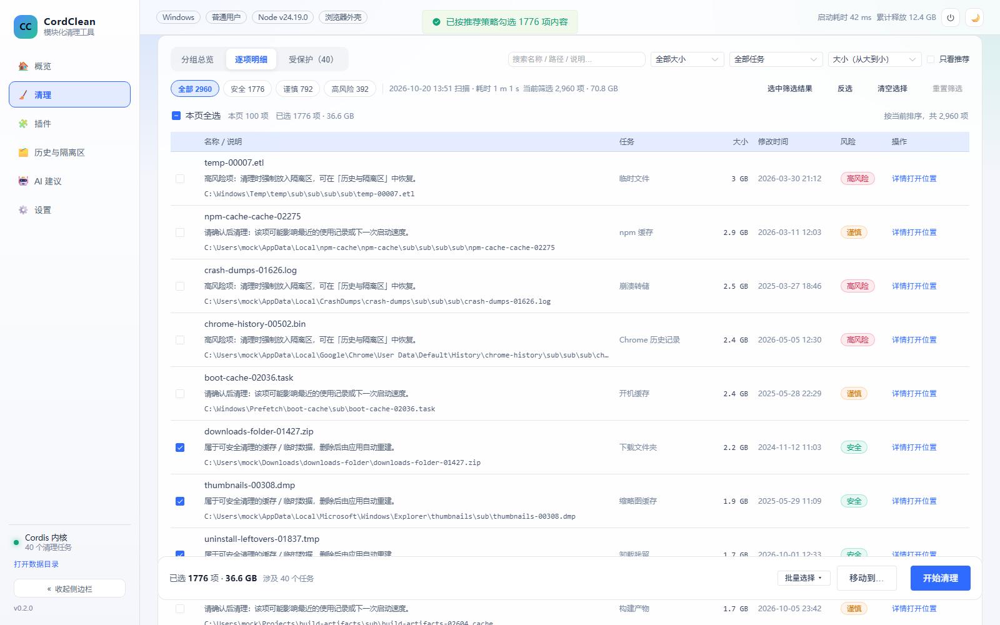
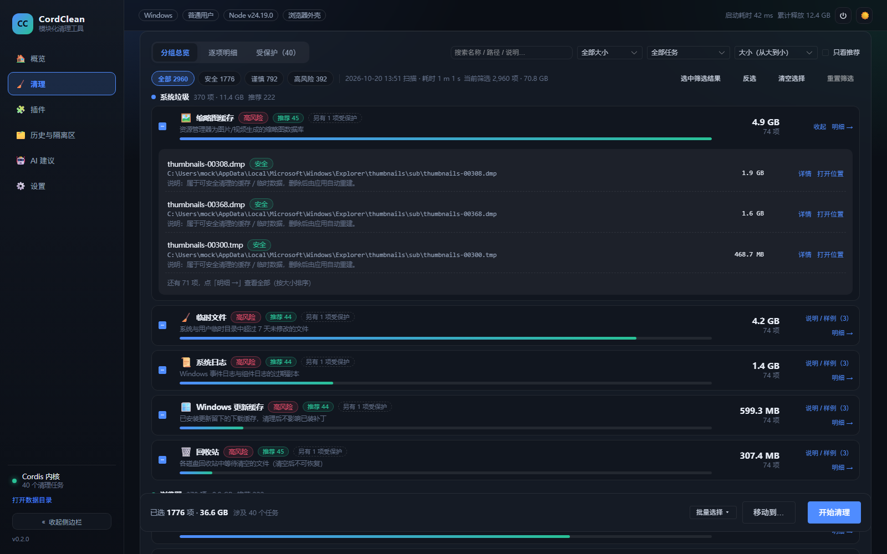
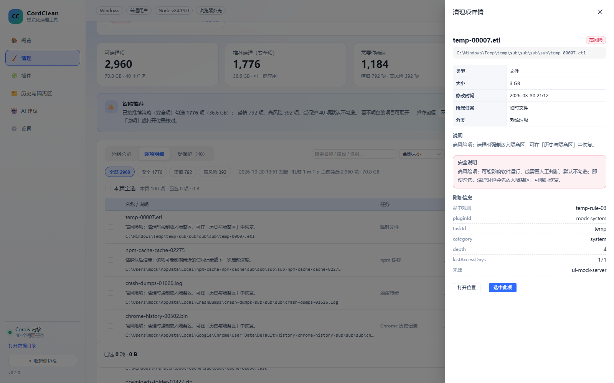

# 独立验收报告：清理选择体验 v2（scan selection UX v2）

- 验收人：verifier（独立验收，未参与实现；只读业务代码，未修改任何业务源码）
- 验收时间：2026-10-20 14:00–14:17（Asia/Shanghai）
- 仓库/工作区：`D:\桌面\deepseek-harness\deepseek-harness-wokplace`（Windows，pnpm workspace）
- 验收对象（工作区未提交改动）：`packages/shared/src/selection.ts`（新增）、`packages/shared/src/index.ts`（+1 行）、`packages/ui/src/views/CleanView.vue`（改版）、`tests/selection.test.ts`（新增 55 条）、`scripts/e2e-ui.mjs`（更新断言）
- 复验说明：首轮验收后 Lead 修复了报告中 4 条低风险建议并重新构建；本验收员对**修复后最终 dist** 完整复验（2026-10-20 14:14–14:20），结果见第七节。
- 最终构建：以 Lead 最后一次小修（`el-pagination` 改为 `size="small"`、E2E 截图前滚动到结果面板）后的源码重新执行 `pnpm build:ui`，本文所有 UI/E2E 证据均基于该最终 dist。

## 结论：**通过**

- 必做检查全部通过：`pnpm typecheck` exit 0、`pnpm vitest run` **289/289 通过**、`pnpm build:ui` exit 0、真实 Electron E2E exit 0 且 **0 条 JS 异常**。
- 独立核对需求语义 **86/86 断言通过**（3000 条合成数据 + 无头 Edge 真实浏览器交互），未发现阻塞性/功能性缺陷。
- 旧功能（扫描取消、候选任务勾选、预演 dryRun、移动到、上次清理结果面板）均验证可用，未回归。
- 首轮记录的 4 条低风险体验建议已被 Lead 全部修复，并在修复后最终 dist 上复验通过（见第六、七节）。
- **修复后复验**：`pnpm typecheck` exit 0、`pnpm vitest run` **289/289** 全绿（46.00 s）、`node scripts/e2e-ui.mjs` exit 0 且 0 JS 异常、团队脚本 `node scripts/verify-clean-ui.mjs` **PASS 25/25**、独立语义验收 **98/98** 断言通过、补充真实 Electron 回归 **10/10**。

---

## 一、必做检查（全部实际执行）

| # | 命令 | 结果 | 关键输出 | 日志 |
| --- | --- | --- | --- | --- |
| 1 | `pnpm typecheck` | **exit 0** | `tsc -p tsconfig.json --noEmit`，无任何诊断输出 | [01-typecheck.log](01-typecheck.log) |
| 2 | `pnpm vitest run` | **exit 0** | **Test Files 40 passed / Tests 289 passed (289)**，Duration **45.55 s**；`tests/selection.test.ts` **55 tests** 399 ms；即原 234 + 新增 55 = 289 | [02-vitest.log](02-vitest.log) |
| 3 | `pnpm build:ui` | **exit 0** | `1631 modules transformed`，`✓ built in 5.92s`，产物 `dist/assets/index-D9l0N17l.js 1,134.03 kB` | [03-build-ui.log](03-build-ui.log) |
| 4 | `node scripts/e2e-ui.mjs` | **exit 0** | 6 个页面渲染正常、真实扫描全链路成功、无 JS 异常（见下） | [04-e2e-electron.log](04-e2e-electron.log) |
| 5 | `node docs/verification/verify-selection-semantics.mjs` | **exit 0** | 3000 条 mock 数据下 **86/86** 断言通过，全流程 0 JS 异常 | [05-mock-semantics.log](05-mock-semantics.log)、[semantics-results.json](semantics-results.json) |
| 6 | `node docs/verification/e2e-regression-extra.mjs` | **exit 0** | 真实 Electron 补充回归 **9/9**（扫描取消、预演弹窗、移动到弹窗） | [06-e2e-extra.log](06-e2e-extra.log) |

### 真实 Electron E2E 关键控制台输出（复验运行，最终 dist）

```
IPC 通道可用： true
侧边栏： 🏠概览 / 🧹清理 / 🧩插件 / 🗂️历史与隔离区 / 🤖AI 建议 / ⚙️设置
✓ 概览 / ✓ 扫描与清理 / ✓ 插件 / ✓ 历史与隔离区 / ✓ AI 清理顾问 / ✓ 设置（6 页截图）
扫描完成，统计卡片： 可清理项5521021.1 MB · 8 个任务 | 推荐清理（安全项）551833 MB · 可一键应用 |
                     需要你确认1谨慎 1 项 · 高风险 0 项 | 受保护（不可清理）5命中路径策略，扫描已跳过
推荐横幅： ✨智能推荐 已按推荐策略（安全项）勾选 551 项（833 MB）；谨慎 1 项、高风险 0 项、受保护 5 项默认不勾选。
默认选择： 已选 551 项 · 833 MB
✓ 视图切换：分组 8 行 / 明细本页 100 行
✓ 详情抽屉： JetBrains 安全 ... 类型 文件夹 大小 647.8 MB 修改时间 — 所属任务 更多开发工具缓存 分类 开发缓存 说明 位于受保护目录
✅ 界面端到端检查通过：6 个页面渲染正常、扫描全链路成功、无 JS 异常
```

真实扫描数据的语义自洽性：可清理 552 项 = safe 551 + caution 1 + risky 0；受保护 5 项不计入可清理/推荐；
默认选择 **551 项** = 全部 safe 且非 protected，与设计 3.2 完全一致（保护项与谨慎项未被默认勾选）。复验运行同一结论。

截图（真实 Electron，最终 dist）：

- 分组总览 + 推荐横幅 + 底部已选：
- 逐项明细（说明/修改时间/风险列）：
- 补充证据：`docs/screenshots/ui-clean.png`、`ui-overview.png`、`ui-plugins.png`、`ui-history.png`、`ui-ai.png`、`ui-settings.png`、`ui-theme-dark.png`、`ui-rail.png`

---

## 二、独立核对需求语义（3000 条 mock 数据，真实浏览器交互）

工具与口径：复用团队工具 `scripts/ui-mock-server.mjs`（固定种子 3000 条：40 任务 / 8 类别 / 40 protected / safe 1776 · caution 792 · risky 392 / 0 字节 90 条），
用**独立编写的** `docs/verification/verify-selection-semantics.mjs` 在无头 Edge 中逐项操作断言；**期望值由原始 fixture 直接逐条统计得到，没有复用 `selection.ts`**，避免"用实现验证实现"。

| 验收要求 | 独立期望 | 实测结果 | 结论 |
| --- | --- | --- | --- |
| 默认推荐只含 safe 且排除 protected/risky | 1776 项 / 36.6 GB | footer `已选 1776 项 · 36.6 GB`，完全相等；footer 无冒险/谨慎标记；`risky 筛选 + 只看推荐` = 0 项 | ✅ |
| 高风险不会自动勾选 | 0 | 0（同上） | ✅ |
| 分组总览按 类别→任务 聚合 | 8 类别 / 40 任务行 | 类别顺序 = CATEGORIES 声明顺序；组数 40；类别内按字节降序；类别行「项数/大小/推荐数」全部与独立统计一致 | ✅ |
| 组内三态勾选 | — | 清空后整组勾选 = 组内 74 项/4.9 GB（精确相符）；再点取消 = 0；含「另有 1 项受保护」的组整组勾选后勾选框为**全选态**、只选中可清理项 74 项（protected 不计入组 ids） | ✅ |
| 展开样例 / 明细下钻 | 前 3 大项 | 展开显示 3 条样例（名称/路径/说明）+「还有 71 项」；点「明细 →」进入该任务 74 项明细、任务筛选同步 | ✅ |
| 搜索（名称/路径/说明） | 296 项 | 搜 `temp` → `当前筛选 296 项`、本页 100 行；选择不丢失（1776 项保持） | ✅ |
| 风险筛选 | risky 392 | 明细仅高风险行、共 392 项 | ✅ |
| 大小筛选 ≥100 MB | 109 项 | 109 项 | ✅ |
| 任务筛选 | 74 项 | 「临时文件」→ 74 项 | ✅ |
| 排序（风险/大小） | — | 风险降序前 100 行全为高风险；大小升序本页单调不减（0 B 显示 `—` 按 0 处理） | ✅ |
| 分页 | 100/页、500/页 | 默认 100 行；下一页 100 行且内容变化；切 500/页=500 行；最后一页 460 行（2960/500 边界正确） | ✅ |
| 跨页选择 | 1 项 | 第 2 页选中 1 项 → 回第 1 页仍 1 项 → 再回第 2 页该行仍勾选 | ✅ |
| 本页全选 / 视图切换保留 | 100 项 | 本页全选 = 100 项；切换分组/明细视图选择不丢 | ✅ |
| 选中筛选结果 / 反选 / 清空 | 392 → 0 → 392 → 0 | 选中筛选结果 = 392；反选（已选=筛选集）= 0；再反选 = 392；清空 = 0；底部出现「392 项高风险 · 将隔离」 | ✅ |
| 明细列（说明/修改时间/风险） | — | 表头含 名称/说明、任务、大小、修改时间、风险、操作；100 行均有 note；修改时间列全部有值；风险列仅 安全/谨慎/高风险；大小列格式正确（0 B 显示 `—`） | ✅ |
| 详情抽屉 | — | 含 类型/大小/修改时间/所属任务/分类/说明/安全说明/附加信息/打开位置/选中或取消选择；完整路径不截断 | ✅ |
| 受保护只读视图 + 原因 | 40 行 | 40 行、无 checkbox、有保护策略说明条；详情含「受保护原因」「受保护项不可清理」，无「选中此项」 | ✅ |
| 清理确认摘要 | 数量/大小/任务分布/高风险隔离 | 推荐选择：`即将清理 1776 项，合计 36.6 GB`、`安全 1776`、任务分布 8 行 + 「还有 32 个任务未列出」、无高风险隔离提示；高风险选择：`392 项/13.2 GB` + `高风险 392` + 「将先放入隔离区，可随时恢复」 | ✅ |
| 清理执行/移动到不破坏真实数据 | — | mock `clean/start`、`files/move` 全链路可调通（dryRun 见下）；真实 Electron 中只打开/取消清理与移动弹窗，不执行删除 | ✅ |

### 3000 条规模下的可用性与性能（无头 Edge，1600×1000）

| 指标 | 实测 |
| --- | --- |
| 首屏到分组行出现（含应用初始化/mock RPC/渲染） | **698 ms** |
| 清空选择 / 风险筛选 / 重置筛选 / 应用推荐（1776 项 Set 重建+重渲染） | 44.4 / 49.9 / 77.0 / 40.7 ms |
| 分组总览行数 | 40 行（只渲染任务级行，展开样例按需渲染） |
| 全流程 JS 异常 / console.error / Log.error | **0 条** |

截图：

- 分组总览（3000 条，展开样例、三态勾选、推荐标签、受保护提示）：
- 逐项明细（100/页、说明、修改时间、风险、详情/打开位置）：
- 暗色主题：
- 详情抽屉：

---

## 三、旧功能回归

| 旧功能 | 验证方式 | 结果 |
| --- | --- | --- |
| 扫描取消 | 补充真实 Electron E2E：未扫描时「取消」禁用；扫描中页面内 5 ms 轮询，在扫描开始后 **7 ms** 点击「取消」→ 扫描正常结束、无 JS 异常（9/9） | ✅ |
| 内核取消语义 | 全量单测 `tests/engine-robust.test.ts`「取消后返回 cancelled 且不再继续产出」随 289 条全绿通过 | ✅ |
| 候选任务勾选 | mock：40 张任务卡片、默认勾选 17 个 defaultSelected 任务；点未选任务卡片计数 17→18；「全选安全任务/清空」可用；`itemsByTask` 任务结果角标正常 | ✅ |
| 预演 dryRun | mock：按钮切「预演清理」→ 确认框「即将预演清理 1776 项…」→ 执行后消息「预演完成：可释放 36.6 GB」→「✅ 上次清理结果」面板出现；真实 Electron：按钮切换 + 确认框文案正确，取消未执行 | ✅ |
| 移动到 | mock：弹窗 → 输入目标目录 → RPC `files/move` 调用成功（mock 返回 0 项）→ 提示「没有项目被移动」，**无未定义函数异常**（修复前 `moveFiles` 未定义的问题已恢复）；真实 Electron：弹窗可打开/取消，不移动真实文件 | ✅ |
| 上次清理结果面板 | mock 预演后出现「✅ 上次清理结果」卡片（释放空间/清理项/隔离/失败四格 + 失败详情折叠） | ✅ |

补充 E2E 截图：`docs/verification/screenshots/e2e-regression-scan-result.png`（真实扫描结果）、`e2e-regression-after-cancel.png`（取消后界面）。

---

## 四、边界检查（mock fixture 变更 + 重载页面实测）

| 场景 | 操作/期望 | 实测 | 结论 |
| --- | --- | --- | --- |
| 空扫描（items=[]） | 统计全 0、推荐 0、无分组、已选 0、空态文案、无异常 | 统计 0/0/0/0，banner「推荐 0 项」，空态「当前筛选没有匹配项」，无 JS 异常 | ✅ |
| 全 protected（3 条全受保护） | 可清理/推荐/需要确认 = 0、分组 0、受保护视图 3 行、已选 0 | 全部符合；受保护项均不可勾选、详情给出原因 | ✅ |
| 0 字节项 | 大小列 `—`、详情大小 `—`、不参与推荐阈值语义破坏 | 2 个 0 字节项大小列均 `—`；0 字节项可正常渲染/详情 | ✅ |
| 无 note 项 | 不渲染空说明行/空说明块，不出现 `undefined` | 有 note 行数 = 2（仅两条带 note 的显示），0 字节无 note 项无说明行，body 无 `undefined`/`NaN` | ✅ |
| 超长路径（约 600 字符）+ 超长名称/说明 | 不产生横向溢出、详情完整展示 | `scrollWidth = clientWidth = 1600`（无横向滚动）；详情抽屉含完整路径尾段（1208 字符不被截断，`word-break: break-all`） | ✅ |

截图：`docs/verification/screenshots/edge-empty-scan.png`、`edge-all-protected.png`、`edge-long-path.png`。

---

## 五、代码审阅（与设计契约逐条比对）

- `packages/shared/src/selection.ts`（564 行）逐函数核对 `docs/scan-selection-design.md` 第 4 节契约：
  - `recommendIds`：仅 safe（`includeCaution` 时含 caution），**永远排除 risky/protected**，minSize 含等于、taskIds 空数组=不限；排序 size 降序 + id 码元序。✅
  - `selectionState`：空 ids → none；全中 → all；部分 → partial。✅
  - `groupByTask`：组内 size 降序、risk 取最高（RISK_META.weight）、未知任务回退、samples 默认 3、组按 bytes 降序 + taskId 码元序。✅
  - `groupByCategory`：只输出有数据分类、顺序 = CATEGORIES 声明顺序、类内 tasks 按 bytes 降序。✅
  - `filterItems`：query 对 title/path/note 大小写不敏感子串；`includeProtected` 默认 false（默认排除受保护项）；risks/taskIds 空数组=不限；保持输入顺序。✅
  - `sortItems` 稳定排序、`mtime-desc` 缺失排最后、`risk-desc` risky>caution>safe；`topNBySize` n≤0 → []。✅
  - `summarizeSelection`：byRisk 三 key 恒存在、byTask 按 bytes 降序、warnCount=caution+risky、riskyIds。✅
  - 纯函数/无 DOM/Node/Vue 依赖、不修改入参；5000 条性能断言（<1000 ms）在单测中通过。✅
- `CleanView.vue` 关键接线审阅：
  - 默认推荐由 `watch(scan)` 在拿到扫描结果时写入选择集（`recommendedIds`），与横幅/统计同源；✅
  - 分组视图的数据源是 `filterItems`（默认排除 protected），而「另有 N 项受保护」来自 `protectedByTask`（全部项），因此组内三态只针对可清理项、受保护项不会卡住勾选框；✅
  - 明细视图 `filtered` 与分组视图共享筛选/排序/选择集；详情抽屉、确认摘要、受保护视图、dryRun/移动到均从同一 store 调用，未见未定义引用；✅
  - `store.moveFiles`/`openPath` 均已导出并被 `CleanView.vue` 正确 import（修复前的 undefined 调用已消除）；✅
- `scripts/e2e-ui.mjs` 更新合理：分组行数在切视图前统计、截图前滚动到 `.result-card`，断言「智能推荐」横幅与默认选择非空；✅

---

## 六、缺陷与建议清单

**无阻断/严重/中/低缺陷。** 首轮记录 4 条低风险体验建议，Lead 已全部修复并复验通过（不阻塞验收）。

| # | 首轮低风险建议 | 修复内容 | 复验证据（最终 dist） |
| --- | --- | --- | --- |
| 1 | 受保护视图搜索框不生效 | `CleanView.vue:152-157` 新增 `protectedFiltered` 按搜索词过滤；无匹配显示「没有匹配…」+「清除搜索」（`:947-950`） | 搜 `temp-cache-00000` → 1 行（共 40）；无匹配提示出现；点「清除搜索」恢复 40 行且搜索框清空 |
| 2 | 取消扫描后仍提示「扫描完成」 | `runScan`/`runScanSingle` 检查 `state.scan?.cancelled`（`:485`、`:496`），提示「扫描已取消，已显示部分结果」 | mock cancelled 报告：提示已取消且无「扫描完成」；真实 Electron：扫描开始后 **6 ms** 点取消 → 消息「扫描已取消，已显示部分结果」 |
| 3 | 全 protected 时副标题显示「1 个任务」 | `scanTaskCount` 改为基于 `cleanableItems` 统计（`:450`） | 全 protected 扫描 → 「可清理项 0 0 B · **0 个任务**」 |
| 4 | 策略变更需手动应用 / includeCaution 文案 | 横幅改为「已按推荐策略（安全项[ + 谨慎项]）」（`:700`）；新增 `policyStale` 黄色提示（`:182-184`、`:704`）；应用推荐消息改「已按推荐策略勾选 N 项内容」（`:305`） | 开启包含谨慎项 → 文案变「安全项 + 谨慎项」、出现「推荐策略已变更…」且选择集保持 1776；应用推荐 → 2568 项/57.6 GB、消息「已按推荐策略勾选 2568 项内容」、提示消失；还原后 1776 项 |

---

## 七、修复后复验（2026-10-20 14:14–14:20，最终 dist）

Lead 根据首轮报告修复 4 条低风险建议后，本验收员对**修复后源码重新执行 `pnpm build:ui`** 得到的最终 dist（`dist/assets/index-DU3qgOUQ.js`，exit 0、1631 modules、6.34 s）完整复验：

| 复验项 | 命令 | 结果 |
| --- | --- | --- |
| 静态类型 | `pnpm typecheck` | **exit 0**（无诊断，日志 `01-rerun-typecheck.log`） |
| 全量单测 | `pnpm vitest run` | **40 files / 289 tests 全绿**，46.00 s（与修复前一致；UI 改动未影响单测，日志 `02-rerun-vitest.log`） |
| 真实 Electron E2E | `node scripts/e2e-ui.mjs` | **exit 0**：6 页正常、真实扫描 552 项可清理、默认选 551、受保护 5/谨慎 1、分组 8 行、明细 100 行、详情抽屉 OK、**0 JS 异常**；横幅新文案「已按推荐策略（安全项）勾选 551 项」（日志 `04-rerun-e2e-electron.log`） |
| 3000 条 mock UI 验收（团队脚本） | `node scripts/verify-clean-ui.mjs` | **PASS 25/25**，0 JS 异常；3000 条 / 40 任务 / 40 protected、推荐 1776 项/36.6 GB；全页截图 `docs/screenshots/scan-select-light.png`、`scan-select-dark.png`（1600×6122，日志 `07-rerun-verify-clean-ui.log`） |
| 独立语义验收（本报告脚本，新增 12 条修复针对性断言） | `node docs/verification/verify-selection-semantics.mjs` | **98/98 断言通过**（首轮 86 + 修复针对性 12），0 JS 异常；首屏 669 ms、最大交互 **78.2 ms**（日志 `05-rerun-mock-semantics.log`、`semantics-results.json`） |
| 补充真实 Electron 回归 | `node docs/verification/e2e-regression-extra.mjs` | **10/10 通过**（新增「取消后提示」断言）；扫描开始后 **6 ms** 取消 → 提示「扫描已取消，已显示部分结果」；预演/移动弹窗正常；0 JS 异常（日志 `06-rerun-e2e-extra.log`） |

**复验结论：通过。** 4 条修复均生效且未引入回归；首轮所有结论（默认推荐策略、千条级分组/筛选/分页/详情/确认摘要、旧功能、边界数据）在最终 dist 上保持不变。
## 八、验收限制说明

- 出于安全考虑，真实 Electron 验收**没有执行真实删除/真实移动**：清理执行链路（dryRun 与 clean/start 参数、高风险隔离、失败详情）由全量单测 + mock RPC 的端到端交互覆盖；真实 Electron 只验证「弹窗打开/文案/取消」与扫描链路。
- 「扫描取消」在内核层的 `cancelled` 语义由 `tests/engine-robust.test.ts` 覆盖（289 条全绿中包含），真实 Electron 已验证 UI 取消按钮时序可触发取消且无异常。
- 3000 条规模验证使用固定种子合成数据（可复现：`--items=3000 --seed=20251020`），数据构成见 `scripts/ui-mock-server.mjs` 头注释。

---

## 九、证据与复现

```bash
# 1) 静态检查 / 单测 / 构建
pnpm typecheck
pnpm vitest run
pnpm build:ui

# 2) 真实 Electron E2E（6 页 + 真实扫描 + 新 UI 断言 + 截图）
node scripts/e2e-ui.mjs

# 3) 独立语义验收（3000 条 mock + 无头 Edge，86 条断言）
node docs/verification/verify-selection-semantics.mjs

# 4) 补充真实 Electron 回归（扫描取消 / 预演弹窗 / 移动到弹窗）
node docs/verification/e2e-regression-extra.mjs
```

| 证据 | 路径 |
| --- | --- |
| typecheck 日志 | `docs/verification/01-typecheck.log` |
| 全量单测日志（40 files / 289 tests / 45.55 s） | `docs/verification/02-vitest.log` |
| UI 构建日志 | `docs/verification/03-build-ui.log` |
| 真实 Electron E2E 日志 | `docs/verification/04-e2e-electron.log` |
| 3000 条独立语义验收日志 | `docs/verification/05-mock-semantics.log` |
| 独立断言明细 JSON（86 条 + 性能指标） | `docs/verification/semantics-results.json` |
| 补充真实 Electron 回归日志（9/9） | `docs/verification/06-e2e-extra.log` |
| **修复后复验**：typecheck / vitest / Electron E2E | `docs/verification/01-rerun-typecheck.log`、`02-rerun-vitest.log`、`04-rerun-e2e-electron.log` |
| **修复后复验**：团队 3000 条 UI 验收 PASS 25/25 | `docs/verification/07-rerun-verify-clean-ui.log` |
| **修复后复验**：独立语义验收 98/98 | `docs/verification/05-rerun-mock-semantics.log` |
| **修复后复验**：补充 Electron 回归 10/10 | `docs/verification/06-rerun-e2e-extra.log` |
| 修复后全页截图（团队脚本，1600×6122） | `docs/screenshots/scan-select-light.png`、`docs/screenshots/scan-select-dark.png` |
| 独立验收截图（3000 条分组/明细/暗色/详情/边界） | `docs/verification/screenshots/` |
| Electron E2E 截图（6 页 + 扫描结果/明细） | `docs/screenshots/ui-*.png` |
